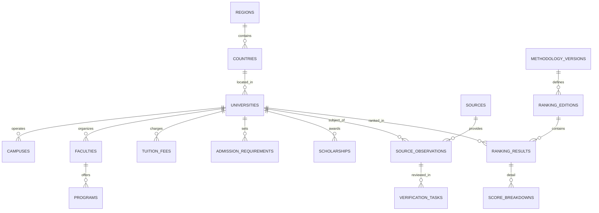

# AHEI Comprehensive Master Development Plan & Implementation Roadmap

**Document:** Comprehensive Master Development Plan  
**Version:** 1.0  
**Date:** 2026-09-30  
**Status:** Approved for Execution  
**Project:** African Higher Education Index (AHEI)  
**Authors:** AI Engineering & Research Team

---

## Executive Summary & Strategic Directive

AHEI (African Higher Education Index) is an Africa-first higher education intelligence platform designed to bring transparency, comparability, and institutional intelligence to African universities. 

Following a comprehensive review of all foundation documents (`AHEI_PRD.prd`, `AHEI_Requirements_Document.md`, `AHEI_Design_Architecture_Document.md`, `AHEI_Task_Breakdown_List.md`, `AHEI_Pyramid_Framework_Roadmap.md`, and the 114 research datasets in `data-research/`), this plan establishes the definitive, unified path forward.

### Resolution to "Research First vs. Build First": Parallel Data-Driven Engineering
We adopt a **dual-track parallel execution model**:
1. **Track A (Core Platform Engineering):** Build the Next.js / Supabase application foundation, the database schema, data verification pipelines, ranking engine, and the public UI shell immediately using the rich seed data already compiled.
2. **Track B (Continuous Data Ingestion & Deep Research):** Ingest the 54-country national registers, expand deep institution profiling (Batches 1–3 onwards), and feed validated records directly into the live database.

---

## 1. Current State Assessment & Foundation Review

### 1.1 Data Assets Status (As of September 2026)
* **National Register Coverage:** Base crosswalk (`official_directory_wikidata_crosswalk.csv`) covers all 54 African nations.
* **Country Extracts:** Over 35 countries have official ministry/regulator registers extracted (e.g. Kenya CUE, Nigeria NUC, South Africa DHET, Ghana GTEC, Egypt MoHE, Uganda NCHE, DRC MESU).
* **Deep Institution Profiles:** 
  * `batch1` (8 institutions: Kenya, South Africa, Ghana, Nigeria, Egypt, Tanzania, Uganda).
  * `batch2` (6 institutions: South Africa, Ethiopia, Nigeria, Rwanda, Senegal, Morocco).
  * `batch3` (6 institutions: JKUAT, Moi, Strathmore, Stellenbosch, Pretoria, Covenant).
  * Total deep-profiled: 20 flagship universities across 11 countries with 51 structured attributes.
* **OCR & Transcription QA:** OCR pipeline validated for Namibia, Burundi, Eswatini, and South Africa private registers.

### 1.2 Core Architectural Principles
1. **Modular Monolith First:** Next.js App Router (Server Components + Server Actions) with TypeScript. No premature microservices.
2. **PostgreSQL as Single Source of Truth:** Hosted on Supabase with strict Row Level Security (RLS) separating public reads from privileged writes.
3. **Evidence & Provenance First-Class:** Every consequential data point (tuition, programs, enrollment, accreditation) is backed by an `observation` linked to a verified `source`.
4. **Deterministic Ranking Engine:** Ranking algorithms are pure functions parameterized by versioned weights, producing reproducible snapshots with full confidence metrics.
5. **Human-in-the-Loop Governance:** AI research outputs are proposals in a verification queue; no AI output publishes unreviewed ranking or accreditation data.

---

## 2. Technical Stack & System Architecture

```text
┌────────────────────────────────────────────────────────────────────────┐
│                        PUBLIC DISCOVERY LAYER                          │
│   Next.js App Router (React Server Components, SEO, OpenGraph)          │
│   Tailwind CSS + Headless UI / Radix primitives + Lucide Icons         │
├────────────────────────────────────────────────────────────────────────┤
│                       DOMAIN SERVICES LAYER                            │
│   /domain/universities   /domain/rankings    /domain/programs          │
│   /domain/sources        /domain/verification /domain/comparison       │
├────────────────────────────────────────────────────────────────────────┤
│                       DATA ACCESS & TRUST CORE                         │
│   Supabase Client / Typed Repositories / Zod Validation Schemas        │
│   Ranking Engine (Deterministic TypeScript library)                    │
├────────────────────────────────────────────────────────────────────────┤
│                      POSTGRESQL DATABASE & STORAGE                     │
│   Relational Schema + Row Level Security (RLS) + pg_trgm Search        │
│   Audit Logs & Change Tracking Triggers                                │
└────────────────────────────────────────────────────────────────────────┘
```

| Layer | Technology Choice | Rationale |
| :--- | :--- | :--- |
| **Frontend Framework** | Next.js (TypeScript, App Router) | SSR/SSG for SEO, server-side caching, fast initial load. |
| **Styling & Components** | Tailwind CSS + custom tokens | Rich modern aesthetics, high performance, full responsiveness. |
| **Database & Auth** | Supabase (PostgreSQL 15+, Supabase Auth) | Relational integrity, built-in RLS, auth, and database migrations. |
| **Search Engine** | PostgreSQL Full-Text Search (`tsvector`) + `pg_trgm` | Zero extra infrastructure cost; fast fuzzy search across institutions. |
| **Validation** | Zod | End-to-end type safety across API boundaries, forms, and imports. |
| **Visualizations** | Recharts / SVG chart primitives | Interactive ranking trends, scorecard radars, and tuition distributions. |

---

## 3. Database Entity-Relationship Model



---

## 4. Phase-by-Phase Implementation Roadmap

### Phase 0: Project Setup & Engineering Infrastructure (Days 1–2)
* [ ] Initialize Next.js project with TypeScript, ESLint, Prettier, and Tailwind CSS.
* [ ] Configure project directory structure following domain-driven patterns (`/src/app`, `/src/domain`, `/src/components`, `/src/lib`, `/src/types`).
* [ ] Setup Supabase local development CLI / project connection with `.env.example` validation using Zod.
* [ ] Configure GitHub repository, branch protections, and CI pipeline (typecheck, lint, test).

### Phase 1: Database Schema, Migrations & Seed Pipeline (Days 3–5)
* [ ] Write PostgreSQL migration scripts:
  * Reference tables: `regions`, `countries`.
  * Institution master: `universities`, `campuses`, `faculties`, `subjects`, `programs`.
  * Academic & financial: `tuition_fees`, `admission_requirements`, `scholarships`.
  * Trust & provenance: `sources`, `source_observations`, `verification_tasks`, `audit_logs`.
  * Ranking infrastructure: `methodology_versions`, `ranking_editions`, `ranking_results`, `score_breakdowns`.
* [ ] Implement Row-Level Security (RLS) policies:
  * Public read on published universities, programs, and published ranking editions.
  * Restricted write/mutate access to authenticated researchers and admins.
* [ ] Build seeding script (`scripts/seed.ts`):
  * Ingest 54 countries and regions.
  * Ingest consolidated pilot institutions (Batches 1–3) with 51 attributes and provenance records.

### Phase 2: Design System, Tokens & Core UI Shell (Days 6–8)
* [ ] Implement AHEI design system tokens:
  * Color palette: Rich deep navy, emerald accent, warm ivory backgrounds, slate neutral text.
  * Typography: Inter / Outfit modern geometric sans.
  * Custom micro-components: `SourceBadge`, `VerificationStatusChip`, `ConfidenceIndicator`, `RankMovementBadge`.
* [ ] Build responsive layout shell:
  * Header with global search, country/ranking menus, and quick compare tray.
  * Footer with regulatory disclosure, methodology link, and data correction portal.

### Phase 3: Public Discovery & Institution Profiles (Days 9–12)
* [ ] **University Profile Page (`/universities/[slug]`):**
  * Hero section: Name, local name, badge, country, sector, founding year, accreditation status.
  * Key Stats Grid: Total enrollment, faculties count, undergraduate vs postgraduate count.
  * Academics Tab: Programs directory categorized by faculty/subject.
  * Costs & Aid Tab: Local vs international undergraduate tuition with academic year context.
  * Admissions Tab: Deadlines (Fall/Spring), general requirements, scholarship opportunities.
  * Provenance Drawer: Detailed source citations, verification date, and data confidence score.
* [ ] **Country & Regional Directories (`/countries/[code]`, `/regions/[slug]`):**
  * Regional aggregation and regulatory authority overview cards.
  * Filterable lists of recognized institutions.

### Phase 4: Deterministic Ranking Engine (Days 13–15)
* [ ] Implement `@ahei/ranking-engine`:
  * Metric normalization (Z-score and min-max with outlier bounding).
  * Missing-data handling: No silent zero-filling; explicit penalty or imputation with provenance flags.
  * Multi-dimensional scoring: Academic reputation, research citations (Crossref/H-index), faculty ratio, and data completeness.
  * Deterministic tie-breaking rules.
  * Confidence scoring based on data freshness and verification completeness.
* [ ] Build Ranking Admin Dashboard (`/admin/rankings`):
  * Configure methodology weights (JSON schema).
  * Calculate preview snapshot.
  * Diff check against previous editions.
  * Single-click publish to public ranking tables.

### Phase 5: Public Ranking Explorer & Comparison Engine (Days 16–18)
* [ ] **Interactive Ranking Tables (`/rankings/africa`, `/rankings/[region]`, `/rankings/subject/[slug]`):**
  * Fast client-side sorting, regional filtering, and sector toggles (Public/Private).
  * Expandable score breakdowns showing dimension contributions.
* [ ] **University Comparison Workspace (`/compare`):**
  * Side-by-side comparison of up to 4 universities.
  * Metric diff highlighting (tuition comparisons converted to USD benchmark, enrollment size, program offerings).
  * Shareable comparison URL query parameters.

### Phase 6: Admin Portal, Verification Queue & Data Management (Days 19–21)
* [ ] **Researcher Verification Queue (`/admin/verification`):**
  * Review pending observations submitted by AI scrapers or researchers.
  * Field-level comparison: Existing value vs New observed value with source link.
  * Actions: Approve, Reject, Request Clarification, Merge.
* [ ] **Institution Editor (`/admin/universities/[id]/edit`):**
  * Direct field edits with mandatory source citation and audit log generation.
* [ ] **Bulk CSV Ingestion Tool (`/admin/ingest`):**
  * Upload batch deep profile CSVs or national register CSVs directly into the staging pipeline.

### Phase 7: Automated QA, Launch Readiness & Documentation (Days 22–24)
* [ ] End-to-end testing with Playwright (Search flow, comparison flow, profile rendering).
* [ ] Unit tests for ranking calculations and score reproducibility.
* [ ] Lighthouse audit: Target >90 score on Performance, Accessibility, Best Practices, and SEO.
* [ ] Production deployment to Vercel and Supabase production instance.

---

## 5. Risk Matrix & Mitigation Strategies

| Risk | Impact | Probability | Mitigation Strategy |
| :--- | :--- | :--- | :--- |
| **Unreliable Tuition Data** | High | High | Keep tuition labeled with exact academic year; never extrapolate without an "estimated" tag; link directly to official fee schedule PDF. |
| **Regulatory Misclassification** | High | Medium | Strictly preserve national regulator categories (e.g. Kenya constituent colleges vs chartered universities) rather than imposing an artificial taxonomy. |
| **Data Staleness** | Medium | Medium | Automated staleness alerts (>12 months without verification); display transparent "Last Verified" badge on all public profiles. |
| **Search Performance Bottlenecks** | Medium | Low | Use PostgreSQL `tsvector` with GiST/GIN indexing; cache popular ranking and profile pages with Next.js ISR (Incremental Static Regeneration). |

---

## 6. Definition of Done (DoD) for MVP Release

1. **Functional Completeness:** Prospective students can search 1,800+ candidate institutions, view deep verified profiles for pilot universities, filter rankings across Africa/regions, and compare up to 4 universities side-by-side.
2. **Provenance & Trust:** 100% of published deep profile attributes display an active source URL, access date, and verification status.
3. **Ranking Reproducibility:** Given the same database snapshot and methodology version, the ranking engine outputs the exact same ordering and scores with 0 delta.
4. **Code Quality & CI:** 0 lint errors, 100% TypeScript type-safety check passing, unit test coverage >80% on core domain logic.
5. **SEO & Mobile Accessibility:** All public routes pass WCAG 2.2 AA accessibility guidelines and generate static OpenGraph metadata.

---

*This document serves as the project's living engineering roadmap. Development begins with Phase 0 and Phase 1 immediately.*
